# ⏱️ Jornify

**Tu reloj de jornada laboral en la bandeja de Windows, que avisa a tu equipo en Microsoft Teams.**

Jornify cuenta el tiempo que llevas trabajando y publica por ti los mensajes de la jornada (inicio, almuerzo, regreso, ausencia y fin) en un canal de Teams, con tu propia cuenta de Microsoft. Se acabó escribir "Buenos días, inicio mi jornada" a mano todos los días. ☕

<p align="center">
  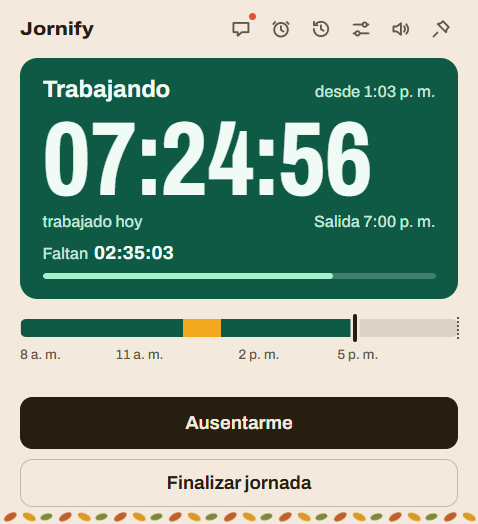
  &nbsp;&nbsp;
  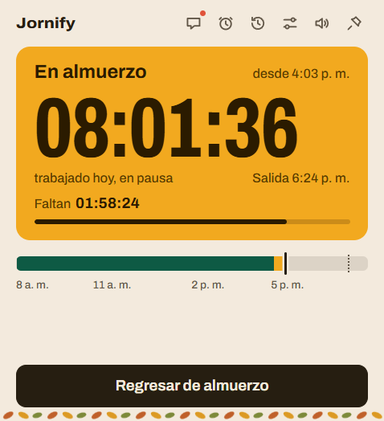
</p>

> 🖥️ Windows 10/11 · ⚡ Electron + TypeScript + React · 🪶 menos de 120 MB de RAM en la bandeja

---

## ✨ Qué hace

- 🟢 **Reloj de la jornada:** HH:MM:SS trabajado, lo que falta, la salida estimada y una barra de progreso. Se pausa solo en el almuerzo y en las ausencias.
- 📅 **Línea del día:** dibuja los tramos reales (trabajo, almuerzo, ausencias) sobre tu horario, con el "ahora" y la salida.
- 💬 **Mensajes en Teams:** cada acción publica su mensaje en el canal que elijas, con tu nombre y la mención que configures.
- 🧵 **Un hilo por jornada:** el inicio abre una publicación nueva y el almuerzo, el regreso, las ausencias y el fin responden dentro de ella. Se puede apagar en Ajustes.
- 📡 **Sin internet no se pierde nada:** el mensaje queda en cola y sale después, con la hora original del evento.
- 🙋 **Nunca publica sin preguntar:** al arrancar pide confirmación antes de registrar el inicio.
- ⏰ **Mensajes programados:** deja listo un almuerzo, un regreso o el fin de la jornada a una hora de hoy.
- 🍽️ **Un almuerzo por jornada:** una vez que sales y regresas, el botón desaparece.
- 🔔 **Recordatorios:** te avisa si pasó la hora de salida o si el almuerzo se alargó.
- 📊 **Historial y Excel:** vista por día y por semana, y reporte `.xlsx` de hoy, la semana, el mes o el rango que quieras.
- 🎨 **Temas de temporada:** otoño, navidad, Halloween, carnaval y las festividades de Colombia, con logo y ícono de bandeja que cambian con la fecha.
- 🔊 **Sonidos** distintos para cada acción, 🌗 modo claro y oscuro, 📌 siempre visible y 🚀 inicio con Windows.

## 📸 Así se ve

<table>
  <tr>
    <td align="center">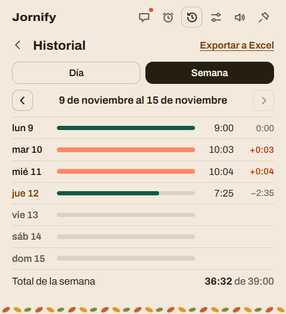<br><b>📆 Historial por semana</b></td>
    <td align="center">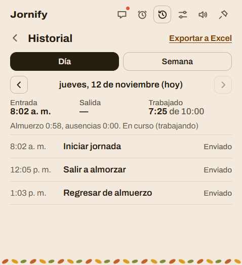<br><b>🗓️ Detalle de un día</b></td>
    <td align="center">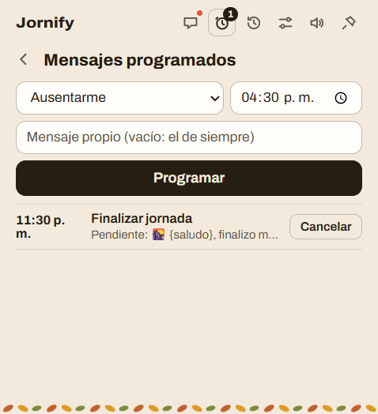<br><b>⏰ Mensajes programados</b></td>
  </tr>
  <tr>
    <td align="center">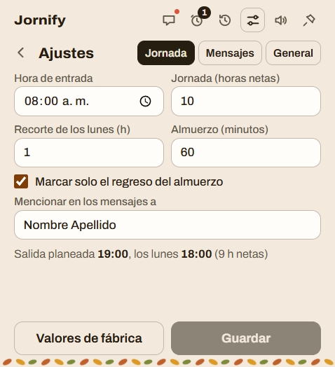<br><b>⚙️ Ajustes de la jornada</b></td>
    <td align="center">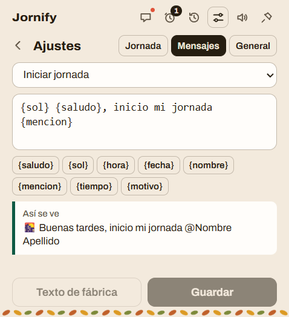<br><b>✏️ Mensajes editables</b></td>
    <td align="center">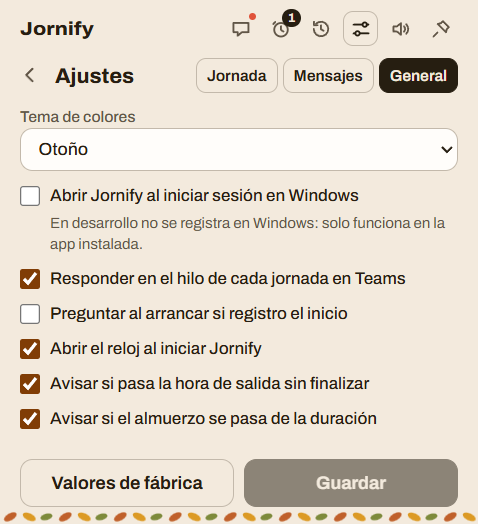<br><b>🧰 Ajustes generales</b></td>
  </tr>
</table>

### 🎉 Temas y modo oscuro

El color de las tarjetas del reloj lo pone siempre el **estado** de la jornada (verde trabajando, azafrán almorzando); el tema solo viste el fondo y el friso del borde inferior.

<table>
  <tr>
    <td align="center">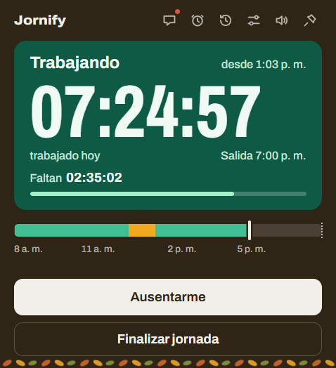<br>🌙 Oscuro</td>
    <td align="center">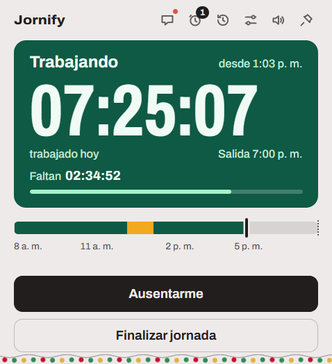<br>🎄 Navidad</td>
    <td align="center">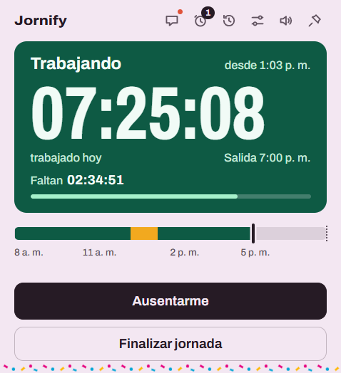<br>🎭 Carnaval</td>
    <td align="center">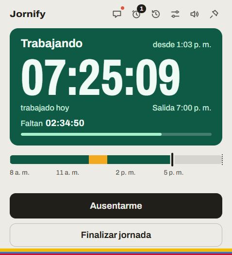<br>🇨🇴 Independencia</td>
  </tr>
</table>

## 🔄 Cómo funciona la jornada

| Acción | Desde | Pasa a |
|---|---|---|
| ▶️ Iniciar jornada | Fuera de jornada | Trabajando |
| 🍲 Salir a almorzar | Trabajando | En almuerzo (una sola vez por jornada) |
| 🍽️ Regresar de almuerzo | En almuerzo | Trabajando |
| ⏸️ Ausentarme | Trabajando | Ausente |
| ↩️ Regresar | Ausente | Trabajando |
| 🌇 Finalizar jornada | Trabajando | Fuera de jornada |

El menú de la bandeja y los botones del reloj ofrecen **solo** las acciones válidas para el estado actual. El estado no se guarda aparte: se deriva del último evento del día en el historial.

La jornada objetivo es de **10 horas netas, sin contar el almuerzo** (los lunes, 9). Entrada 8:00 + 10 h + 1 h de almuerzo = salida 7:00 p. m. Todo se cambia en Ajustes.

## 🚀 Instalación (para usar la app)

1. 📥 Descarga `Jornify-Instalador-<versión>.exe` de la sección **Releases** del repositorio (o genéralo tú: ver Desarrollo).
2. ▶️ Ejecútalo: se instala solo para tu usuario, sin pedir administrador, y se abre.
3. 🛡️ El instalador **no está firmado**: si Windows muestra "Windows protegió su PC", pulsa **Más información → Ejecutar de todos modos**.
4. 🔗 Conecta Teams (ver la sección siguiente).

Para actualizar, instala el `.exe` nuevo encima: tu historial y tu configuración se conservan. Al desinstalar tampoco se borran (`%APPDATA%\Jornify`).

## 🔗 Conectar con Microsoft Teams

Jornify publica con **Microsoft Graph** usando tu inicio de sesión (PKCE; el token se guarda cifrado con `safeStorage`). Hace falta registrar la app una vez en **Microsoft Entra ID**:

1. 🆕 *Registros de aplicaciones* → nueva → **solo este directorio** (un solo inquilino).
2. 🖥️ Plataforma **Cliente móvil y de escritorio** con redirección `http://localhost`, y "Permitir flujos de cliente público" en **Sí**.
3. 🔑 Permisos delegados de Microsoft Graph: `User.Read`, `ChannelMessage.Send`, `Team.ReadBasic.All`, `Channel.ReadBasic.All` (y `User.ReadBasic.All`, opcional, para que la mención sea real y notifique).
4. 🧾 En la pestaña **Teams** de Jornify pega el *ID de la aplicación* y el *ID de directorio (inquilino)*, inicia sesión y elige el equipo y el canal.

> ℹ️ Si el inquilino bloquea el consentimiento de usuarios, un administrador debe pulsar "Conceder consentimiento de administrador". Los antiguos Incoming Webhooks de Office 365 **no se usan** (dejaron de funcionar en mayo de 2026).

## 🛠️ Desarrollo

**Requisitos:** Windows 10/11, Node.js 22.12 o superior (se probó con la 24) y npm.

```bash
npm install            # instala las dependencias
npm run dev            # la app en desarrollo, con recarga
npm run build          # compila main, preload y renderer a out/
npm start              # ejecuta lo compilado
npm run typecheck      # TypeScript estricto (main/preload y renderer)
npm test               # pruebas con Vitest
npm run package     # genera el instalador NSIS en dist/
npm run package:dir   # solo dist/win-unpacked/, para probar sin instalar
```

> 🧪 Para probar sin tocar tus datos reales: `$env:JORNIFY_CARPETA_DATOS="$env:TEMP\jornify-prueba"; npm run dev`
>
> ⚠️ `npm run dev` y la app instalada comparten `%APPDATA%\Jornify` y la instancia única: cierra una antes de abrir la otra.

### 🏷️ Publicar una versión

Un flujo de GitHub Actions (`.github/workflows/release.yml`) compila el instalador en una máquina Windows y lo adjunta a un release cuando se sube una etiqueta `v*`:

```bash
# 1. sube "version" en package.json (p. ej. 0.1.1) y haz commit
git tag v0.1.1
git push origin main --tags
```

La etiqueta debe coincidir con la versión de `package.json`; el flujo revisa los tipos y las pruebas antes de empaquetar, y si algo falla no publica nada. El release queda con notas automáticas y el instalador adjunto.

### 🗂️ Estructura

```
src/main/        proceso principal (Node/Electron) y la lógica pura, sin Electron:
                 estado, tiempo, plantillas, historial, controlador, cola, programador,
                 recordatorios, temas, iconos, reporte, publicadores/ (Graph y prueba)
src/preload/     API segura expuesta a la interfaz (contextBridge)
src/renderer/    interfaz en React
resources/       logo clásico para el instalador y los sonidos (WAV)
scripts/         utilidades (regenerar sonidos y logo)
tests/           pruebas de Vitest
docs/capturas/   imágenes de este README
```

### 🧱 Tecnologías

| | |
|---|---|
| 🖥️ App | Electron 45, electron-vite |
| 🧠 Lenguaje | TypeScript estricto |
| 🎛️ Interfaz | React 19, CSS Modules, fuente Archivo variable |
| 💾 Datos | SQLite (`better-sqlite3`) y `electron-store` |
| 🔐 Teams | Microsoft Graph, `@azure/msal-node` |
| 📑 Reportes | `exceljs` |
| ✅ Validación | `zod` |
| 🧪 Pruebas | Vitest |
| 📦 Instalador | electron-builder (NSIS) |

### 📐 Convenciones

- 🇪🇸 Nombres, comentarios y textos de interfaz en **español**.
- 🔒 `contextIsolation` activado, `nodeIntegration` desactivado y `sandbox` activado: la interfaz solo usa la API del preload. Todo lo que llega por IPC se valida con `zod`.
- 🧩 La lógica no importa Electron, para poder probarla sin abrir la app.
- 📝 `config.json` está versionado: un cambio de formato va en `migrarConfig`.

## 💾 Tus datos

Todo vive en `%APPDATA%\Jornify\`:

| Archivo | Qué guarda |
|---|---|
| `historial.db` | cada evento de la jornada, su mensaje y si se publicó |
| `config.json` | horario, plantillas, canal y preferencias |
| `tokens.bin` | sesión de Microsoft, cifrada |
| `logs/` | registro de la app |

Los secretos nunca van en texto claro.

## 📏 Rendimiento

Medido con la app empaquetada (memoria privada de todos los procesos, lo que muestra el Administrador de tareas):

| Situación | Medido | Meta |
|---|---|---|
| 🪟 Solo en la bandeja | 82 a 85 MB | < 120 MB |
| ⏱️ Con el reloj abierto | 142 a 196 MB | < 220 MB |
| 😴 CPU en reposo | 0 % | ≈ 0 % |

Al cerrar el reloj la ventana se destruye (no se oculta) para liberar su proceso; la app sigue viva en la bandeja.

## 📚 Más documentación

- 📖 [`ESPECIFICACION.md`](ESPECIFICACION.md): la especificación completa del producto.
- 🧭 [`CLAUDE.md`](CLAUDE.md): decisiones técnicas, convenciones y detalles de cada módulo.

## 🗺️ Estado

Las ocho fases del plan están hechas: base, lógica, ventana del reloj, Teams por Graph con cola, historial y ajustes, recordatorios con inicio con Windows y empaquetado. Quedan como ideas opcionales firmar el instalador y la actualización automática.
